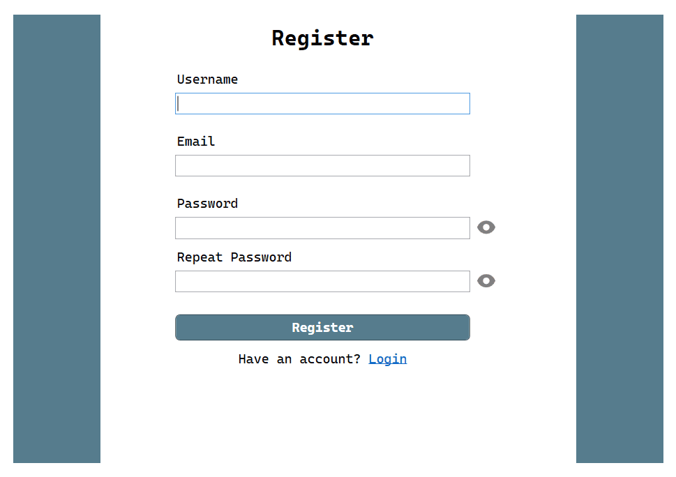
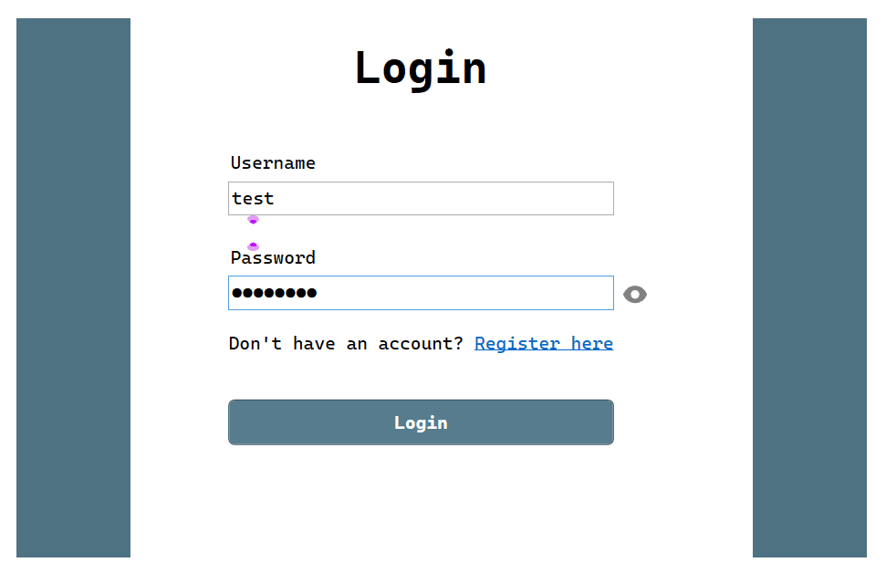
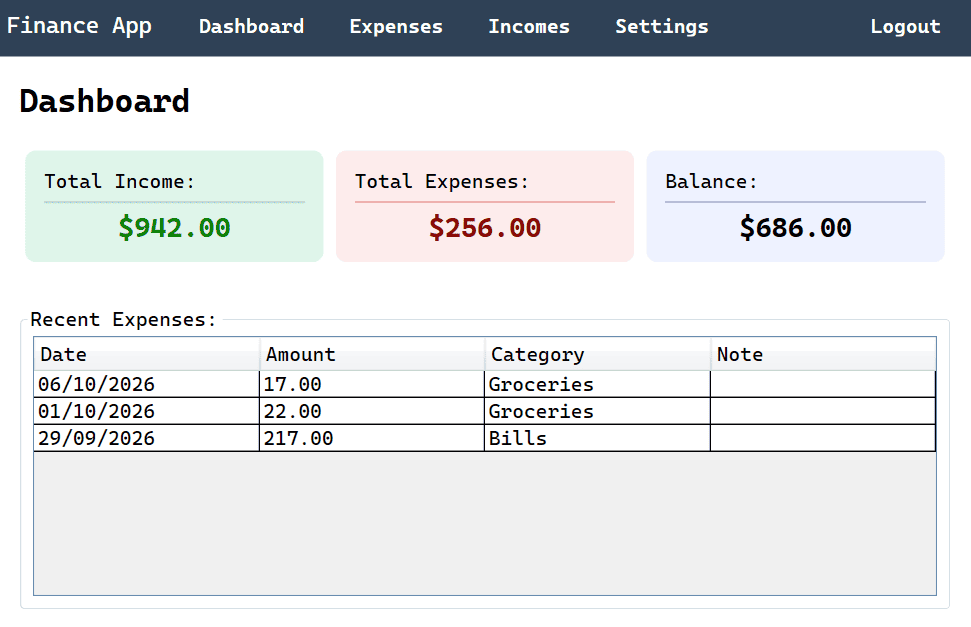
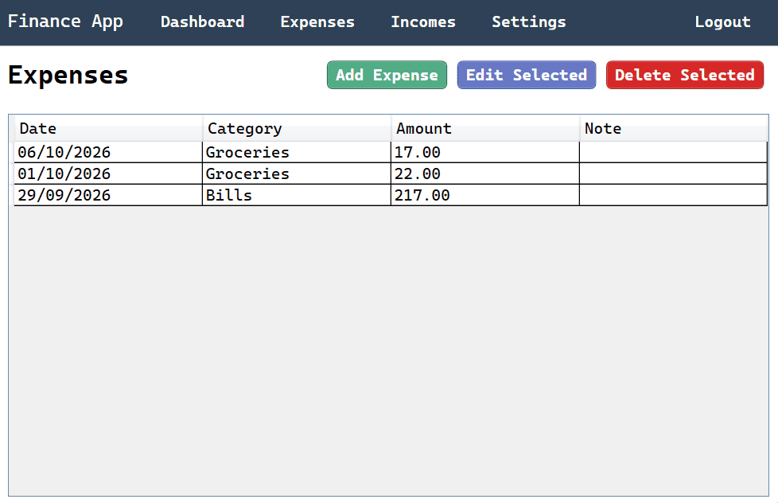
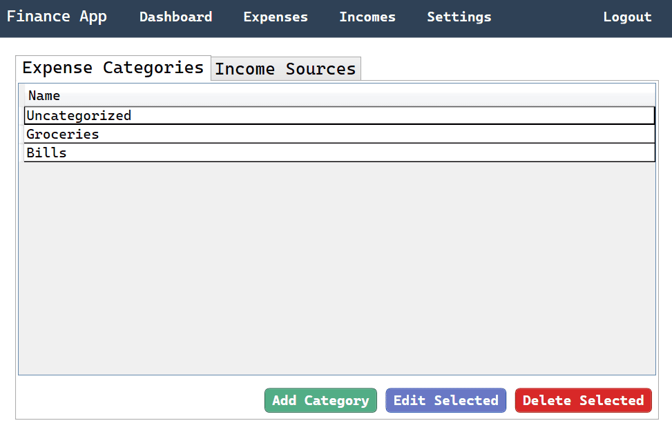
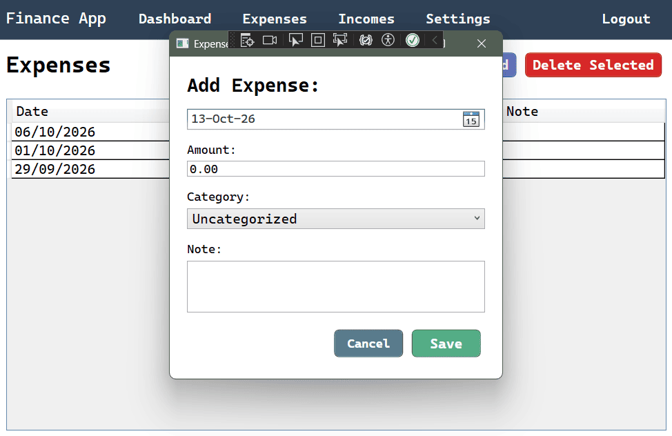

# Personal Finance Tracker

A **WPF** desktop application for tracking personal income and expenses, with user authentication and custom categories for each.

A study project initially built in the end of 2025.

## Features
- User registration and login.
- Track incomes and expenses separately (with CRUD functionality).
- Create custom categories for incomes and for expenses.

## Tech Stack
- C# / .NET Framework 4.7.2
- WPF (XAML)
- SQL Server LocalDB (embedded `Database.mdf`)

## Setup
1. Clone the repository.
2. Open the solution in Visual Studio.
3. Build and run (F5).

The database ships with the project as an embedded `.mdf` file (no SQL Server installation or setup scripts required).

## Screenshots

### Register:

### Login:

### Main view / Dashboard:

### Expenses view:

### Categories view:

### Add expenses dialog:
